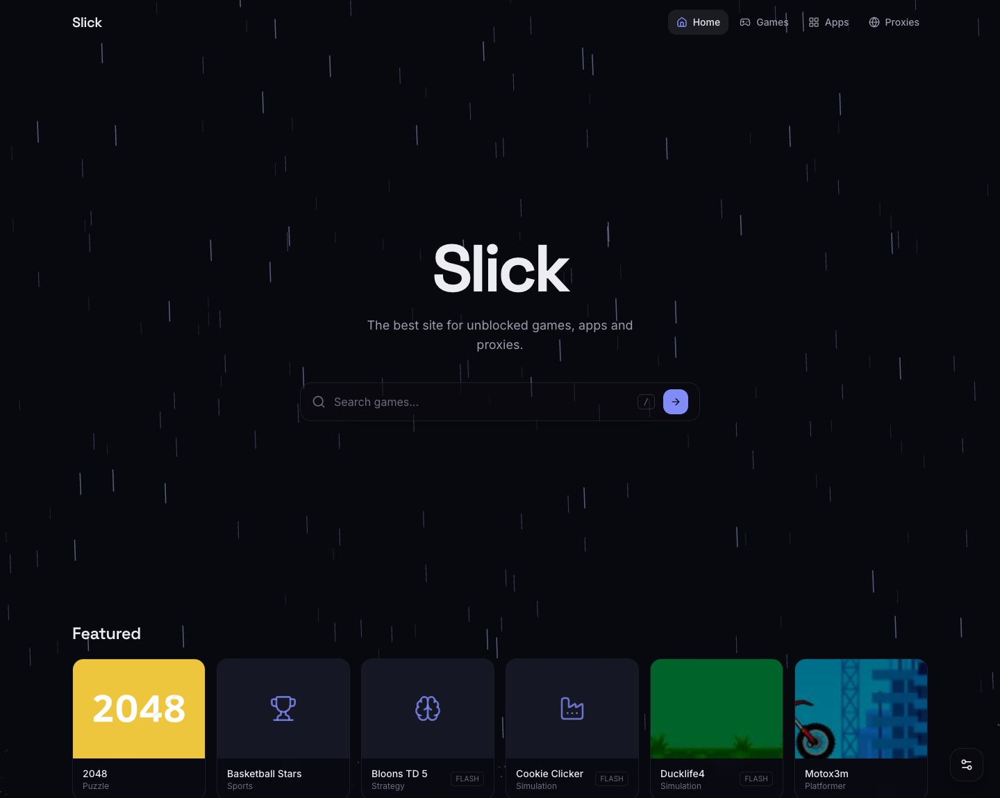

# Slick

Slick is a website for playing browser games and using handy web apps, even on networks that block them. The site is fully static by design, so anyone can host a copy for free and move it to a new domain if the old one gets blocked!



## Features

- **Games:** about 770 HTML5 and Flash games, with search, categories and favorites.
- **Apps:** Custom TI-84 graphinc calculator clone, Desmos, GeoGebra, Photopea, Excalidraw, Python, a notes app, a timer and more.
- **Proxies:** a page of proxy links. You can also add your own!
- **Customizing:** animated backgrounds, accent colors, a tab cloak that makes the tab look like Google Classroom or another school site, and a panic key.

Settings and favorites are only saved in your browser, and are not sent to any cloud service.

## Deploy

[](https://app.netlify.com/start/deploy?repository=https://github.com/worships/slick)
[](https://vercel.com/new/clone?repository-url=https://github.com/worships/slick)
[](https://render.com/deploy?repo=https://github.com/worships/slick)

**Cloudflare Pages:** fork this repo, then in Cloudflare go to Workers & Pages, Create, Pages, Connect to Git. Use `npm run build` as the build command, `build` as the output folder, and set `NODE_VERSION` to `22`.

**Anywhere else:** run `npm install && npm run build` and upload the `build` folder.

If your domain gets blocked, add a new one to the same project in your host's dashboard.

## Run it locally

You'll need [Node.js](https://nodejs.org) 22+. The catalog scripts also need [Bun](https://bun.sh).

```sh
git clone --recursive https://github.com/worships/slick.git
cd slick
bun install
bun run dev
```

(You can also use `npm`, `pnpm`, or `yarn`)

Already cloned without `--recursive`? Run `git submodule update --init`.

## Adding games and apps

Everything on the site comes from `catalog/games.json`. The `catalog` folder is a git submodule, so the list lives in its own repo and can be shared between copies of the site.

Add an entry to `games` or `apps`:

```json
{
	"id": "my-game",
	"name": "My Game",
	"category": "Arcade",
	"type": "url",
	"src": "https://example.com/my-game/",
	"thumb": "https://example.com/my-game/cover.png"
}
```

Set `type` to `url` for a normal web page, `html` for an `index.html` hosted on jsDelivr, or `flash` for a `.swf` file. `thumb` is optional. Then run `bun run catalog:validate` to check for mistakes.

Apps can also be hosted by the site itself: put them in `static/apps/<name>/index.html` and use `/apps/<name>/index.html` as the `src`.

To update the catalog without redeploying, set `catalogUrl` in `src/lib/data/site.ts` to its jsDelivr link, like `https://cdn.jsdelivr.net/gh/YOUR-NAME/slick-catalog@main/games.json`.

## Credits

Backgrounds are based on [Animate UI](https://animate-ui.com). Flash runs on [Ruffle](https://ruffle.rs).